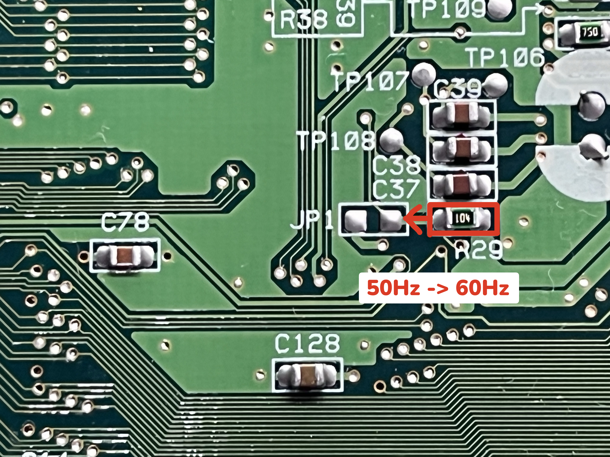
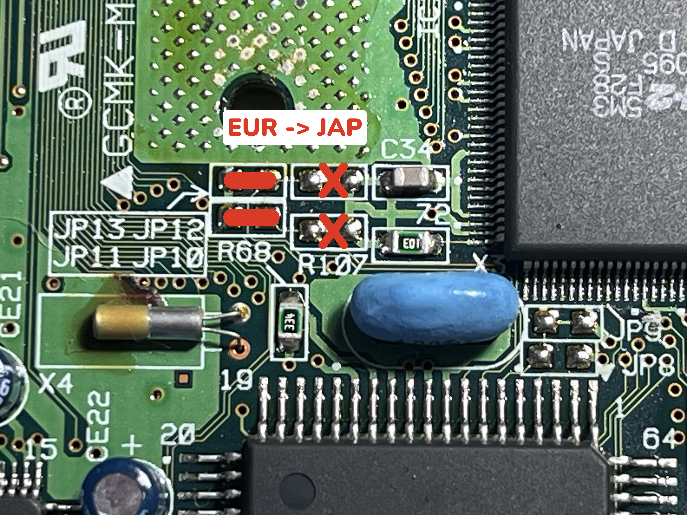
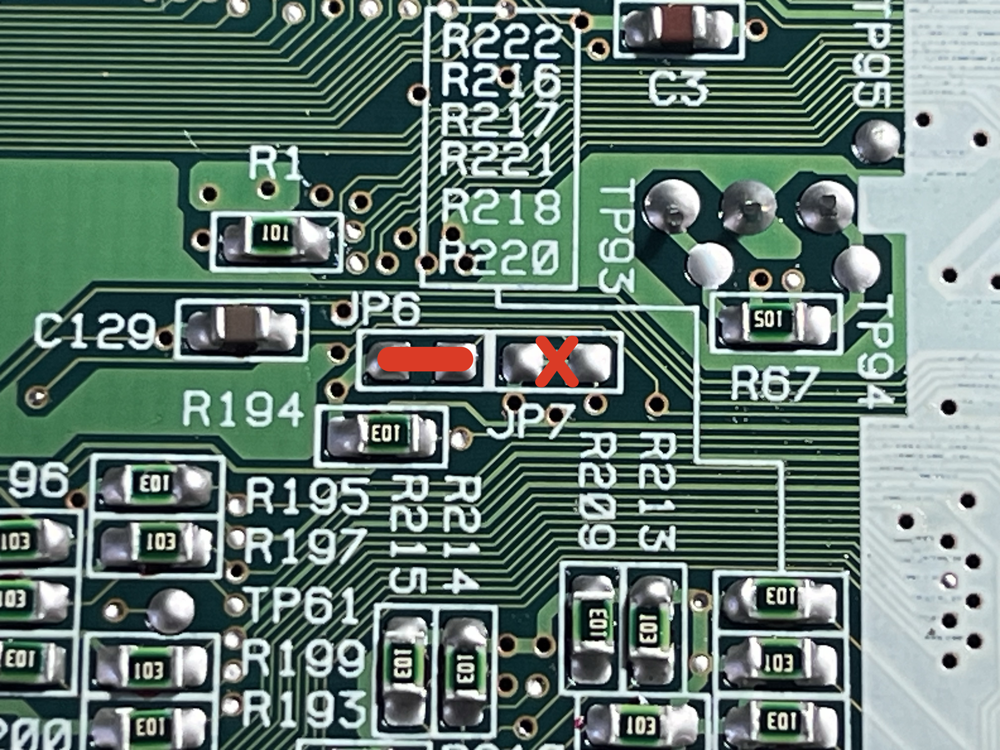

# PAL Jumper Settings (VA PAL SD)
The jumper settings on my Australian PAL Saturn, identified as "PC BD SATURN MAIN VA PAL SD 837-12135". 

If modiyfing jumpers, ensure you open jumpers first and verify they are open before bridging the alternate to ensure you don't accidentally short +5V to GND. 

## Jumpers
| JP   | Setting | Purpose                                   | Location  |
|------|---------|-------------------------------------------|-----------|
| JP1  | Open    | Ties video line to +5V -> 60Hz            | Underside |
| JP2  | 100KΩ   | Ties video line to GND -> 50Hz            | Underside |
| JP3  | Closed  | IC20 (315-5746) option, beside p7 OSCSW   | Topside   |
| JP6  | Open    | Ties SMPC AC1 (315-5744 p5) to +5V        | Underside |
| JP7  | Closed  | Ties SMPC AC1 (p5) to GND                 | Underside |
| JP8  | Open    | Ties SMPC AC2 (p6) to +5V                 | Topside   |
| JP9  | Closed  | Ties SMPC AC2 (p6) to GND                 | Topside   |
| JP10 | Closed  | Ties SMPC AC3 (p7) to +5V                 | Topside   |
| JP11 | Open    | Ties SMPC AC3 (p7) to GND                 | Topside   |
| JP12 | Closed  | Ties SMPC AC4 (p8) to +5v                 | Topside   |
| JP13 | Open    | Ties SMPC AC4 (p8) to GND                 | Topside   |
| JP17 | Open    | Unpopulated SW4 p2 (likely NTSC/PAL sw)   | Underside |
| JP18 | Closed  | Unpopulated SW4 p4, tied to GND (PAL)     | Underside |
| JP19 | Open    | Unpopulated SW4 p3 (likely NTSC/PAL sw)   | Underside |
| JP20 | Open    | IC20 (315-5746) option, near X1           | Topside   |
| JP21 | Closed  | IC20 (315-5746) option, near X1           | Topside   |

## Region (SMPC area code)

The four common pads of JP6/7, JP8/9, JP10/11 and JP12/13 go to the SMPC (Sega 315-5744) pins 5, 6, 7 and 8 (ports R50-R53, per the Sega VA0 service schematic). Each pair is "+5 V pad / GND pad".

| Region        | Pin 5 (AC1) | Pin 6 (AC2) | Pin 7 (AC3) | Pin 8 (AC4) | Code         |
|---------------|-------------|-------------|-------------|-------------|--------------|
| Japan         | JP6 (1)     | JP9 (0)     | JP11 (0)    | JP13 (0)    | 0001 = 1     |
| North America | JP7 (0)     | JP9 (0)     | JP10 (1)    | JP13 (0)    | 0100 = 4     |
| Europe / PAL  | JP7 (0)     | JP9 (0)     | JP10 (1)    | JP12 (1)    | 1100 = **C** |

## Clock chip (IC20 315-5746)

IC20 is a Hitachi PLL clock generator. It is fed by crystal X1 (17.7344 MHz on PAL boards, which is 4x the PAL colour subcarrier). It produces the dot clock, the CPU/sound clocks and the colour subcarrier (FSC) for the video encoder. Pin functions are from the Sega Saturn PAL Service Manual 13-1 (1995):

| Pin  | Name         | Function                                                              |
|------|--------------|-----------------------------------------------------------------------|
| 1    | NPSEL        | NTSC (5V) / PAL (0V) mode select                                      |
| 2    | DOTSEL       | 320 pixel (0V) / 352 pixel (5V) select, driven by the SMPC, no jumper |
| 6    | EXTCLK       | External clock input (internal pull-down)                             |
| 7    | OSCSW        | Crystal (5V) / external clock on EXTCLK (0V), internal pull-up        |
| 9/10 | OSOUT2/OSIN2 | Second crystal (X2), not fitted                                       |
| 25/26| OSIN1/OSOUT1 | Crystal X1                                                            |
| 28   | FSC          | Colour subcarrier output to the video encoder                         |

On the VA0 board, NPSEL has a +5V jumper (JP18) and a GND jumper (JP19), OSCSW has JP4 (+5V) and JP5 (GND), and JP3 ties the unused OSIN2 to +5V. The VA SD numbering is different (JP17-JP19 go to SW4 on this board). JP3, JP20 and JP21 sit around IC20 and X1, so they are most likely the VA SD versions of these options. JP3 is right beside pin 7 (OSCSW). The exact mapping is not yet confirmed and needs a meter check.

## SW4 (JP17-JP19)
SW4 is an unpopulated switch footprint near the backup battery. JP17 goes to SW4 pin 2 and seems to go nowhere else. JP19 goes to SW4 pin 3 and JP18 goes to SW4 pin 4 (GND), and both run across the board. VA0 has an equivalent unfitted "SW2 (NOT USED)" that, with its jumpers, sets the NTSC/PAL pin (pin 7) of the Sony CXA1645 video encoder. So SW4 is most likely a factory NTSC/PAL (50/60Hz) switch position, with JP18 holding it at PAL (low). Not yet confirmed: check continuity from JP19 to CXA1645 pin 7, IC20 pin 1 (NPSEL) or VDP2 (315-5690) pin 79.

## Video Mode Switch
The JP1/JP2 common line feeds VDP2 (315-5690) pin 79 (NTSC/PAL). On VA1 boards the same line also drives IC20 pin 1 (NPSEL). To switch a PAL 50Hz to 60Hz, move the 100KΩ (104) resistor from R29 to JP1.

## EUR to JAP
To change a PAL (area code C) board to Japan (area code 1), open the old jumpers first, then bridge the alternates:

1. Cut the JP12 and JP10 traces, and bridge JP13 and JP11 (AC4 and AC3 go to 0).
2. Cut the JP7 trace and bridge JP6 (AC1 goes to 1).
3. Leave JP8/JP9 as they are (AC2 stays 0).

Changing region does not change the video rate. Do the 50Hz to 60Hz change as well if you want Japanese games to run at full speed.
